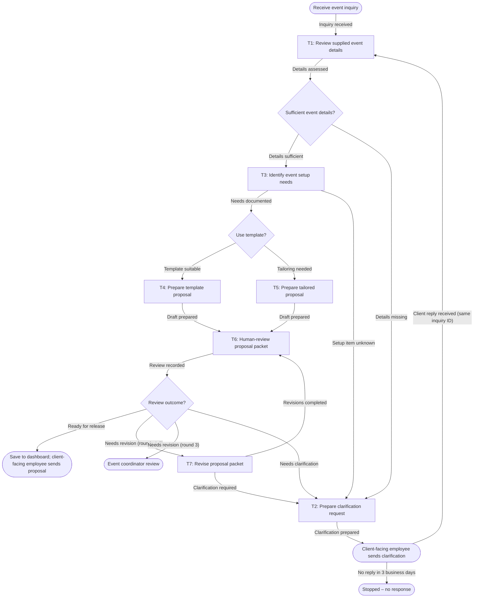

# Workflow of Tasks

## 1. Workflow Goal

This workflow supports the goal in our completed [team charter](../../README.md#team-charter). The workflow coordinates Review supplied event details, Identify event setup needs, Prepare template proposal, Human-review proposal packet, Revise proposal packet, Prepare clarification request, Prepare tailored proposal. Its intended result is: A proposal packet and recorded acceptable review outcome are available as evidence that this workflow run completed.

## 2. Workflow Trigger

A supplied client event inquiry and any accompanying event details begin one workflow run.

## 3. Completion Condition at Runtime

A proposal packet and recorded acceptable review outcome are available as evidence that this workflow run completed.

## 4. General Workflow

The workflow starts when A supplied client event inquiry and any accompanying event details begin one workflow run..

T1 · Review supplied event details: Examine the supplied event information for guest count, event type, date, time, and other details needed to prepare a proposal. T3 · Identify event setup needs: Document the indicated chairs, tables, AV equipment, event-space needs, and unresolved setup questions from the supplied details. T4 · Prepare template proposal: Prepare a proposal using an available template and the documented event setup needs. T6 · Human-review proposal packet: Review proposal completeness and consistency with the supplied details; flag unresolved details and personal-information retention concerns, then record the review outcome. T7 · Revise proposal packet: Address review comments using the supplied event details and return the revised packet for human review. T2 · Prepare clarification request: List the missing event details and prepare a focused clarification request for follow-up. T5 · Prepare tailored proposal: Prepare a tailored proposal when a template is not suitable for the documented event setup needs.

Task connections: START → T1 (Inquiry received); T1 → D1 (Details assessed); T3 → D2 (Needs documented); T3 → T2 (Setup item unknown); T4 → T6 (Draft prepared); T5 → T6 (Draft prepared); T6 → D3 (Review recorded); T7 → T6 (Revisions completed); T7 → T2 (Clarification required); T2 → HANDOFF (Clarification prepared); HANDOFF → T1 (Client reply received, same inquiry ID); HANDOFF → STOPPED (No reply within 3 business days).

Routing: D1 · Sufficient event details? — Details sufficient (all six required fields are found and none conflict: event type, event date, start time, end time, guest count, preferred layout) → T3 · Identify event setup needs; Details missing (any required field is missing or conflicting) → T2 · Prepare clarification request. D2 · Use template? — Template suitable (the event type is on the template list in setup-and-routing-rules.md, the guest count fits a standard layout of the recommended room, and there are no special requests) → T4 · Prepare template proposal; Tailoring needed (any one of those three conditions is not met) → T5 · Prepare tailored proposal. D3 · Review outcome? — Ready for release → END · Save to dashboard and send; Needs revision → T7 · Revise proposal packet (at most 2 revision rounds per inquiry ID; a third Needs revision goes to the event coordinator instead); Needs clarification → T2 · Prepare clarification request.

T6 · Human-review proposal packet is performed by Proposed reviewer. The human reviewer receives the completed proposal packet, source event details, and setup-needs assessment from T4 or T5. Within 10 minutes of receipt, they manually compare the packet with the source information and team criteria, then record the review outcome and supporting evidence directly in the proposal packet or generated Markdown as Ready for release, Needs revision, or Needs clarification. The reviewer hands the recorded outcome to D3 · Review outcome. Packets needing edits go to T7, and packets missing essential details go to T2. The reviewer records the revision round number. After 2 revision rounds, a further Needs revision outcome goes to the event coordinator instead of T7. When the outcome is Ready for release, the app saves the final proposal as a .docx in the proposal dashboard under its inquiry ID. The client-facing employee downloads it, adds the client's name and contact details outside the system, and sends it to the client. The system never sends proposals itself.

Stopped cases: (1) The client does not reply to a clarification request within 3 business days, including one reminder sent on day 2. The run is marked Stopped – no response, and no client personal information is kept. (2) A packet receives a third Needs revision outcome. The run is marked Stopped – coordinator review and handed to the event coordinator.

Exception and handoff instructions: In every case, record the status and evidence under the inquiry ID without client personal information, and notify the event coordinator. T1: If personal details cannot be removed, stop and ask the employee to remove them by hand; if extraction fails, show the employee a blank field form to fill in. T3: If no room fits or a setup item is unknown, route to T2. T4: If the template cannot be filled, route to T5. T5: If drafting fails, the employee drafts by hand from the T3 assessment, then sends it to T6. T2: If drafting fails, the employee writes the request from the missing-field list. T6: Missing or invalid inputs go to T7 or T2. T7: Hand off to the reviewer when a limit is reached or a finding needs a human decision; missing information goes to T2.

## 5. Workflow Diagram

